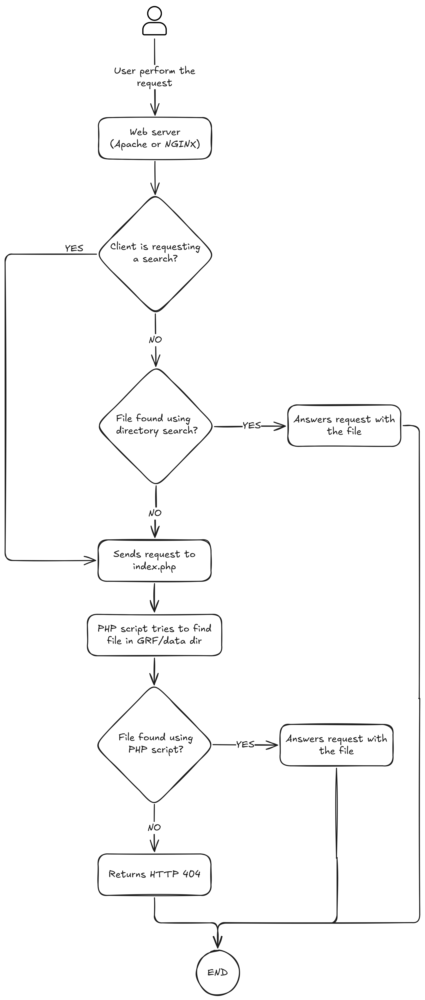

Setup the remote client
=======================

The remote client exist to help users without a FullClient on their computer to play by downloading resources from an external server.
Because pushing directly the fullclient on a server/ftp can provoke some errors, this tool allow to :

 - Get the files from a client used in another domain (Cross-origin resource sharing).
 - Extracting files directly from GRF archive (versions 0x200 and 0x300 supported).
 - Converting BMP files to PNG to speed up the transfer.
 - Optimized to don't call any script if files are already extracted/converted (resource friendly).
 - **File Index for O(1) lookups**: Files are indexed at startup for instant lookups instead of sequential search through GRFs.
 - **Gzip/Deflate Compression**: Automatically compresses text-based responses (XML, TXT, LUA, etc.) to reduce bandwidth.
 - **HTTP Cache Headers** (ETag, Cache-Control, 304 Not Modified) for browser caching.
 - **LRU Cache** for fast repeated file access (in-memory caching).
 - **Missing Files Log** for tracking and debugging missing game assets.
 - **Health Check API** (`/api/health`) for monitoring and diagnostics.
 - **Korean Path Mapping** for CP949/EUC-KR filename encoding support.
 - **Warm Cache** for pre-loading frequently accessed files at startup.
 - **Startup Validator** for system validation and diagnostics.
 - **Doctor Command** (`php doctor.php`) for CLI-based diagnostics.

## Quick Start

### Prerequisites

- **Web Server**: Apache (`mod_rewrite`, `mod_headers`) or Nginx (`ngx_http_core`, `ngx_http_fastcgi`, `ngx_http_headers`)
- **PHP**: 7.4+ (64-bit x64 recommended; **mandatory for GRFs > 2GB**)
- **PHP Extensions**: `zlib`, `mbstring` (required); `gd` (with TrueColor), `iconv` (recommended)

### 1. Add your fullclient

Just put your GRFs files and DATA.INI file in the `resources/` directory.
Overwrite the `BGM/`, `data/` and `System/` directories with your own folders.

**Note: to be sure to use a compatible version of your GRFs, download *GRF Builder* and repack them manually (Option > Repack type > Repack), it will ensure the GRFs files are converted in the proper version**

### 2. Run diagnostics

```bash
php doctor.php              # Basic validation
php doctor.php --deep       # Deep validation with encoding analysis
```

### 3. Start the server

Using Docker or your preferred web server (Apache, Nginx).

---
## Wiki

[](https://deepwiki.com/MrAntares/roBrowserLegacy-Remoteclient-PHP)

## Diagnostics & Validation

### Doctor Command

The `doctor.php` command provides comprehensive system validation:

```bash
# Basic validation
php doctor.php

# Deep validation (includes encoding analysis - slower but thorough)
php doctor.php --deep

# JSON output (for automation)
php doctor.php --json

# Show help
php doctor.php --help
```

**What it validates:**
- ✓ PHP version (minimum 7.4.0)
- ✓ Required extensions (zlib, mbstring)
- ✓ Optional extensions (gd, iconv)
- ✓ Required files and directories
- ✓ Configuration (DATA.INI, memory limit)
- ✓ GRF file format (0x200 / 0x300)
- ✓ GRF file table (zlib compressed)
- ✓ Path encoding (UTF-8 vs legacy CP949/EUC-KR)
- ✓ Mojibake detection (--deep mode)

**Example output:**
```
╔════════════════════════════════════════════════════════════════════════════╗
║            🏥 roBrowser Remote Client - Doctor (PHP)                       ║
║                        System Diagnosis                                    ║
╚════════════════════════════════════════════════════════════════════════════╝

================================================================================
📋 VALIDATION REPORT
================================================================================

✓ INFORMATION:
   PHP version: 8.3.6
   Extension 'zlib' loaded
   Extension 'mbstring' loaded
   DATA.INI found: resources/DATA.INI
   Valid GRF: data.grf (version 0x200)
   Memory limit: 1000M

================================================================================
✅ Validation completed successfully!
================================================================================
```

### Validation API

| Endpoint | Method | Description |
|----------|--------|-------------|
| `GET /api/validate` | GET | Run basic validation |
| `GET /api/validate?deep=true` | GET | Run deep validation |

---

## Performance Features

### HTTP Cache Headers

The server implements proper HTTP cache headers for browser caching:

- **ETag**: Content-based validation for conditional requests
- **304 Not Modified**: Reduces bandwidth by validating client cache
- **Cache-Control**: Optimized per file type
  - Game assets (sprites, maps, etc.): 1 year with `immutable`
  - Other files: 30 days
- **Expires**: HTTP/1.0 compatibility

This significantly reduces bandwidth and speeds up repeated requests, as unchanged files are served from browser cache.
### LRU File Cache

The server implements an in-memory LRU (Least Recently Used) cache for file content:

- **Default**: 100 files, 256MB max memory
- **O(1)** get/set operations
- Automatic eviction of least recently used files
- Configurable via environment variables

```env
CACHE_ENABLED=true
CACHE_MAX_FILES=100
CACHE_MAX_MEMORY_MB=256
```

| Setting | Description | Default |
|---------|-------------|---------|
| `CACHE_ENABLED` | Enable/disable cache | `true` |
| `CACHE_MAX_FILES` | Max files in cache | `100` |
| `CACHE_MAX_MEMORY_MB` | Max memory usage | `256` MB |

### Korean Path Mapping

Many Ragnarok GRF files contain Korean filenames encoded in CP949/EUC-KR. When these are read on non-Korean systems, they appear as mojibake (garbled characters).

**The Problem:**
```
Client requests: /data/texture/유저인터페이스/t_배경3-3.tga
GRF contains:    /data/texture/À¯ÀúÀÎÅÍÆäÀ̽º/t_¹è°æ3-3.tga
```

**The Solution:**

The server uses a `path-mapping.json` file to map Korean UTF-8 paths to their GRF equivalents:

```env
PATH_MAPPING_ENABLED=true
PATH_MAPPING_FILE=path-mapping.json
```

| Setting | Description | Default |
|---------|-------------|---------|
| `PATH_MAPPING_ENABLED` | Enable/disable path mapping | `true` |
| `PATH_MAPPING_FILE` | Path to mapping file | `path-mapping.json` |

**Generating path-mapping.json automatically:**

```bash
# Generate path-mapping.json by scanning your GRFs
php tools/convert-encoding.php

# Preview without writing (dry run)
php tools/convert-encoding.php --dry-run

# Custom output file
php tools/convert-encoding.php --output=custom-mapping.json

# Verbose output
php tools/convert-encoding.php --verbose
```

The tool will:
1. Read DATA.INI to find your GRF files
2. Scan each GRF for non-UTF-8 filenames (Korean CP949/EUC-KR)
3. Convert filenames to proper Korean UTF-8
4. Generate mappings: Korean path → GRF path

**Example output:**
```json
{
    "generatedAt": "2026-01-18T12:00:00Z",
    "paths": {
        "data/texture/유저인터페이스/file.tga": "data/texture/À¯ÀúÀÎÅÍÆäÀ̽º/file.tga"
    },
    "summary": {
        "totalFiles": 450000,
        "totalMapped": 12500
    }
}
```

### Warm Cache

The server can pre-load frequently accessed files into the LRU cache at startup or on-demand:

- **Essential files** pre-loaded for faster initial requests
- **Pattern matching** with wildcards for file groups
- **Memory limit aware** - stops warming when limits reached
- **Statistics tracking** for monitoring
- **API endpoint** for on-demand warming
- Configurable via environment variables

```env
WARM_CACHE_ENABLED=true
WARM_CACHE_MAX_FILES=50
WARM_CACHE_MAX_MEMORY_MB=50
```

| Setting | Description | Default |
|---------|-------------|---------|
| `WARM_CACHE_ENABLED` | Enable/disable warm cache | `true` |
| `WARM_CACHE_MAX_FILES` | Max files to warm | `50` |
| `WARM_CACHE_MAX_MEMORY_MB` | Max memory for warming | `50` MB |

**Essential files warmed by default:**
- `data\clientinfo.xml` - Client configuration
- `data\lua files\*.lub` - Lua scripts
- `data\sprite\*.spr` - Character sprites (basic)
- `data\texture\*.bmp` - UI textures

**API Endpoints:**

| Endpoint | Method | Description |
|----------|--------|-------------|
| `/api/warm-cache` | GET | Get warm cache status and stats |
| `/api/warm-cache/run` | POST | Trigger cache warming manually |

### GRF Version Support

| Version | Status | Notes |
|---------|--------|-------|
| 0x200 | ✅ Supported | 32-bit file offsets, no DES encryption |
| 0x300 | ✅ Supported | 64-bit file offsets (files > 4GB), no DES encryption |
| DES Encrypted | ✅ Supported | |

## API Endpoints

The remote client provides several API endpoints for monitoring and diagnostics:

### Health Check & Validation

| Endpoint | Method | Description |
|----------|--------|-------------|
| `GET /api/health` | GET | Complete system health status |
| `GET /api/health/simple` | GET | Simple status check (fast) |
| `GET /api/validate` | GET | Run startup validation |
| `GET /api/validate?deep=true` | GET | Run deep validation with encoding |
| `GET /api/cache-stats` | GET | Cache and index statistics |
| `GET /api/missing-files` | GET | Missing files log summary |
| `POST /api/missing-files/clear` | POST | Clear missing files log |
| `GET /api/warm-cache` | GET | Warm cache status and stats |
| `POST /api/warm-cache/run` | POST | Trigger cache warming |
| `GET /api/path-mapping` | GET | Path mapping statistics |

**Example response for `/api/health`:**

```json
{
    "status": "ok",
    "timestamp": "2026-01-18T12:00:00+00:00",
    "grfs": {
        "total": 2,
        "valid": 2
    },
    "cache": {
        "enabled": true,
        "items": 45,
        "hitRate": "96.5%"
    },
    "index": {
        "totalFiles": 450000
    },
    "hasWarnings": false
}
```

## Running the Remote Client

### Using Docker container

You can use this setup with the container to run the remote client API. Using docker container does not handle/copy 
the game files. You need to set up them first on the directory.

Copy the file [.env.example](.env.example) to the same directory as .env

After copying the game files and modifiying your .env file, you can start the container services.

#### I want to use NGINX server

You can start using the remote client with NGINX using the following command:

```bash
docker compose --profile nginx up --build
```

The webserver will be answering requests on the 80 port.

#### I want to use Apache server

```bash
docker compose --profile apache up --build
```

### Web Server Requirements & Modules

Whether running via Docker, a standalone Linux server, or a Windows web server (Apache Lounge / XAMPP / IIS), ensure the following web server modules and configurations are present:

#### Apache Modules

| Module | Status | Purpose | How to Enable |
|--------|--------|---------|---------------|
| **`mod_rewrite`** | **Required** | Handles URL rewriting: rewrites `.bmp` requests to `.png` and routes missing assets to `index.php` | `a2enmod rewrite` / `LoadModule rewrite_module modules/mod_rewrite.so` |
| **`mod_headers`** | **Required** | Sets CORS headers (`Access-Control-Allow-Origin`, `Access-Control-Allow-Headers`) allowing web clients to fetch resources | `a2enmod headers` / `LoadModule headers_module modules/mod_headers.so` |
| **`mod_mime`** | **Recommended** | Defines custom Ragnarok asset MIME types (`.act`, `.spr`, `.pal`, `.gat`, `.gnd`, `.rsw`, `.rsm`) | Usually enabled by default (`mod_mime.so`) |
| **`mod_deflate`** (or `mod_gzip`) | **Recommended** | Compresses game assets and text/XML/Lua responses at server level to save bandwidth | `a2enmod deflate` / `LoadModule deflate_module modules/mod_deflate.so` |
| **`mod_speling`** | Optional | Provides case-insensitive URL correction (`CheckSpelling On`, `CheckCaseOnly On`) | `a2enmod speling` / `LoadModule speling_module modules/mod_speling.so` |

> **Important Apache Directives:**
> - **`AllowOverride All`** (or `AllowOverride FileInfo Options Limit`) must be enabled in your `<Directory>` configuration so that [.htaccess](.htaccess) takes effect.
> - **`ErrorDocument 404 /remote/index.php`** (or `/index.php` depending on your subpath) routes missing files to the PHP GRF extractor.

#### Nginx Modules

Nginx includes the required modules by default (compiled-in core modules):

| Module | Status | Purpose | Key Directives |
|--------|--------|---------|----------------|
| **`ngx_http_core_module`** | **Required** | Core request routing and fallback: `error_page 404 /index.php;` and `try_files $uri $uri/ =404;` | Built-in |
| **`ngx_http_headers_module`** | **Required** | Sets CORS headers for browser clients | `add_header 'Access-Control-Allow-Origin' '*';` |
| **`ngx_http_fastcgi_module`** | **Required** | Passes PHP requests to PHP-FPM | `fastcgi_pass`, `fastcgi_param` |
| **`ngx_http_gzip_module`** | **Recommended** | Compresses responses for custom RO asset types | `gzip on; gzip_types application/ro-action ...;` |
| **`ngx_http_rewrite_module`** | **Recommended** | URL rewriting and redirect rules | Built-in |

> **Custom MIME Types for Nginx:** Include Ragnarok file types in your configuration (e.g. `/etc/nginx/conf.d/ro-mime-types.conf`):
> ```nginx
> types {
>     application/ro-action   act;
>     application/ro-sprite   spr;
>     application/ro-palette  pal;
>     application/ro-ground   gnd;
>     application/ro-altitude gat;
>     application/ro-world    rsw;
>     application/ro-model    rsm;
> }
> ```

### PHP Requirements & Configuration

#### PHP Version & Architecture

| Requirement | Value | Details |
|-------------|-------|---------|
| **Minimum Version** | **PHP 7.4.0** | Baseline language compatibility |
| **Recommended Version** | **PHP 8.1 - 8.5+** | Improved memory efficiency, execution speed, and stability |
| **Architecture** | **64-bit (x64)** | **CRITICAL for GRFs > 2 GB.** 32-bit (x86) PHP has a signed 32-bit integer ceiling (`PHP_INT_MAX = 2,147,483,647`). Any GRF over 2 GB (such as official `data.grf` at ~4.2 GB) will cause `filesize()` and `fseek()` to overflow and fail. |

#### PHP Extensions

| Extension | Status | Purpose | Impact if Missing |
|-----------|--------|---------|-------------------|
| **`zlib`** | **Required** | Decompresses GRF 0x200 / 0x300 file tables and compressed entries (`gzuncompress`); compresses HTTP responses | **Fatal**: GRF archives and files cannot be read |
| **`mbstring`** | **Required** | Multibyte encoding conversion (UTF-8, CP949 / EUC-KR) and string handling | **Fatal**: Korean paths and filenames will fail to resolve |
| **`gd`** | **Recommended** | Converts in-game BMP textures to PNG on the fly to accelerate client downloads | BMP files are served raw without PNG conversion; calls to `imagecreatetruecolor()` are skipped safely |
| **`iconv`** | **Recommended** | Korean path encoding analysis and character set translation (`tools/convert-encoding.php`) | Deep encoding analysis tool will be unavailable |
| **`opcache`** | **Recommended** | In-memory opcode caching for PHP scripts | Higher CPU usage / slower response times under load |

#### Recommended `php.ini` Directives

```ini
; Required & recommended extensions
extension=zlib
extension=mbstring
extension=gd
extension=iconv

; Memory limit (large GRF indexing and cache warming need adequate memory)
memory_limit = 512M      ; Increase to 1000M for very large archives

; Execution timeout (in seconds)
max_execution_time = 60
```

## FAQ

### How I can change NGINX/Apache virtual host configuration?

The vhosts configuration for both Apache and NGINX are baked into the container recipe. If you need to change this, 
you have to modify the respective [Apache Dockerfile](docker/apache/Dockerfile) or [NGINX dockerfile](docker/nginx/Dockerfile)
and re-run the docker compose command.

You can also override vhost configuration on **/etc/apache2/sites-available/000-default.conf** for Apache or **/etc/nginx/conf.d/default.conf** for NGINX
using docker compose specification adding a bind mount, example:

```yaml
volumes:
  - ./:/var/www/html:ro
  - ./my-own-nginx.conf:/etc/nginx/conf.d/default.conf
```

### How can I make sure that my remote client works as expected?

If you set up all the required files correctly, you can run the python script [tester.py](docker/test/tester.py). This
script reads a file list in the same directory (list.txt) that contains multiple filenames that should be in a GRF.
The script will request each file to the target webserver defined in **TARGET_SERVER_ADDRESS** variable, checking if the 
server answers with an HTTP code 200, if not, a new log file is created with the HTTP code and the file url requested, so
you can debug it afterward.

Example, running the list against a working server (localhost, apache and nginx):

Apache
```
=== Final result ===
Total: 2784 | OK: 2784 | FAIL: 0
Elapsed time: 110.10 seconds
```
NGINX
```
=== Final result ===
Total: 2784 | OK: 2784 | FAIL: 0
Elapsed time: 1.86 seconds
```

### How this remote client works?


